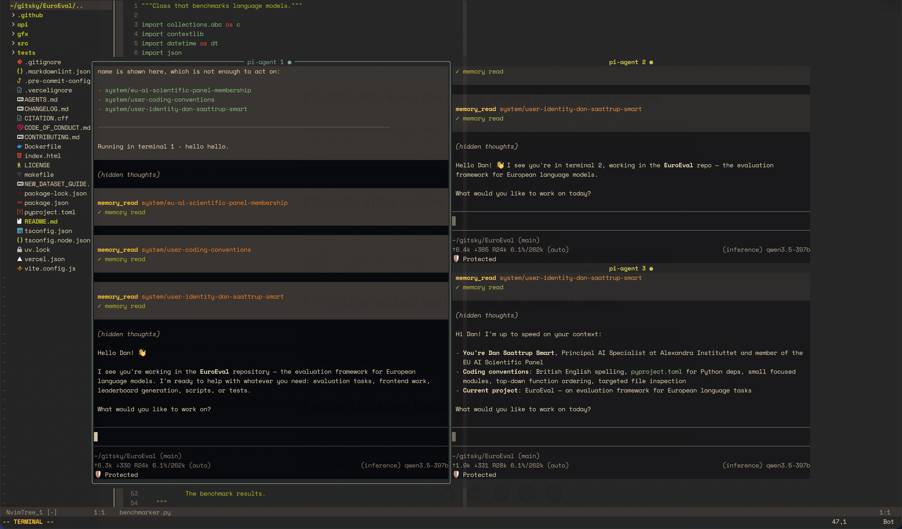

# pi-agent.nvim

A tiny Neovim plugin that opens your [Pi](https://github.com/) agent in a centered floating window, rooted at the current git repo (or `cwd` if there's no git worktree).



## Features

- Floating Pi area, 90% × 90% of the editor by default, that recenters and resizes with Neovim
- Automatically launches Pi from the original checkout's git root (falling back to `cwd` outside Git), even after following managed worktrees
- Follows the focused session's validated Git worktree in Neovim's global cwd, including delayed session metadata and resume/title changes
- Multiple Pi terminal sessions in tiled floating panes
- Direct iTerm2 vertical tabs show one aggregate Pi status (Need input, Working,
  Error, Finished, or Idle) and the Pi logo while any pane is running
- Toggle in and out — all `pi` sessions persist across toggles, restoring the exact focused pane and terminal buffer until you close their pane or exit Pi
- Scroll through Pi history with the mouse wheel; new output preserves your browsed position and following resumes at the bottom or when returning to the prompt
- Configurable size, border, and command

## Requirements

- Neovim 0.9+
- The [`pi`](https://github.com/) CLI on your `$PATH`

## Installation

### lazy.nvim

```lua
return {
  "saattrupdan/pi-agent.nvim",
  config = function()
    require("pi-agent").setup()
  end,
}
```

### packer.nvim

```lua
use({
  "saattrupdan/pi-agent.nvim",
  config = function()
    require("pi-agent").setup()
  end,
})
```

## Configuration

The defaults:

```lua
require("pi-agent").setup({
  command = "pi",      -- command to run in the floating terminal
  width   = 0.9,       -- fraction of editor width
  height  = 0.9,       -- fraction of editor height
  border  = "rounded", -- any value accepted by nvim_open_win
  pane_gap = 1,         -- empty cells between split panes (0 disables)
  keymap  = "<C-,>",   -- toggle keymap (string or table of strings; set to false or "" to disable)
  abort_keymap = "<C-c>", -- terminal-mode keymap that aborts the current Pi run (string or table; set to false or "" to disable)
})
```

`pane_gap` only affects tiled multi-pane layouts; a single Pi pane keeps the full configured floating area.

### Changing or disabling the default keymap

By default `<C-,>` toggles the window in both normal and terminal mode. To use a different binding, e.g. `<leader>pi`:

```lua
require("pi-agent").setup({ keymap = "<leader>pi" })
```

Any string accepted by `vim.keymap.set` works here — for example `"<leader>p"`, `"<F4>"`, or `"<C-g>p"`.

To bind multiple keymaps (e.g. keep `<C-,>` for local use and add `<leader>cc` for tmux compatibility):

```lua
require("pi-agent").setup({
  keymap = { "<C-,>", "<leader>cc" }
})
```

To disable the built-in keymap and define your own:

```lua
require("pi-agent").setup({ keymap = false })
vim.keymap.set("n", "<F4>", "<cmd>PiAgent<CR>", { desc = "Toggle Pi agent" })
```

> Note: some terminals don't transmit `<C-,>` as a distinct key. If pressing it does nothing, pick another binding or configure your terminal to send the right escape sequence (e.g. via Kitty/WezTerm key mappings).

## Usage

| Command         | Description                         |
| --------------- | ----------------------------------- |
| `:PiAgent`      | Toggle the floating Pi area         |
| `:PiAgentOpen`  | Open (or focus) the floating panes  |
| `:PiAgentClose` | Hide all floating panes             |

Default keymap: `<C-,>` toggles the Pi area in normal and terminal modes. See [Configuration](#configuration) to change or disable it.

### Pane controls

Pi panes use buffer-local mappings, so they only apply inside visible Pi terminal buffers.

| Key                     | Modes             | Description                                      |
| ----------------------- | ----------------- | ------------------------------------------------ |
| `<C-s>`                 | Normal, terminal  | Split the current Pi pane and start a fresh Pi   |
| `<C-x>`                 | Normal, terminal  | Close the current Pi pane/session (confirm with `y`) |
| `<C-w>h/j/k/l`          | Normal, terminal  | Move to the neighboring visible Pi pane          |
| `<C-w><C-w>`            | Normal, terminal  | Cycle through visible Pi panes                   |

Splits preserve the current session and open a new Pi session in the new pane. Landscape panes split vertically (side-by-side); visually portrait/narrow panes split horizontally (top/bottom). When multiple panes are visible, the active pane is marked by a highlighted border/title. Closing a pane asks for a one-key confirmation, then stops only that pane's Pi job and collapses the layout so the neighbor consumes the space.

When Neovim runs directly in iTerm2 (not inside tmux), the enclosing vertical
tab shows one aggregate status for all Pi panes, without conversation titles: Need input if any pane has a blocking prompt,
otherwise Working if any is running, Error if a pane failed, Finished with a
green dot if a response completed while the iTerm2 tab was inactive, or Idle
without a dot. New panes start Idle; completing a response in the active tab
stays Idle. Selecting a Finished tab acknowledges all completions and returns
to Idle. Hiding the Pi area does not stop these updates. The tab uses the same
Pi mark as the splash screen instead of Neovim's icon while panes exist. On the last pane's close or Neovim exit, the
plugin clears its status and restores iTerm2's automatic app icon. iTerm2 asks
you to approve the session-local icon change the first time it is made; choose
**Allow Always** so it can also restore the icon on exit. No iTerm2 Python API
or `it2` command is needed. Inside tmux, neither the tab status nor icon is
changed: tmux does not reliably forward these iTerm2 control sequences.

### Aborting a Pi run

Pi normally cancels the current generation with `<Esc>`, but `<Esc>` is overloaded in Neovim (leaving terminal mode, dismissing popups, etc.). Inside the agent buffer, `<C-c>` is mapped to send `<Esc>` to Pi so you can abort a run without leaving terminal mode. Change it via `abort_keymap`, or set it to `false` / `""` to disable.

### Starting a new session

Inside the agent buffer, `<C-l>` sends `/new` to Pi so you can start a fresh session without typing the slash command manually. Change it via `new_session_keymap`, or set it to `false` / `""` to disable.

## How it works

When the first Pi pane is created, the plugin captures the original Git checkout (or global `cwd` outside Git). Every later split is launched from that checkout, never from a followed worktree. Pi's JSONL session header supplies each pane's managed cwd when available; otherwise the OSC title's cwd basename is resolved only when it uniquely matches `git worktree list --porcelain` for the original checkout. The global cwd follows the focused validated worktree, including while Pi is hidden and you switch to file-tree or ordinary buffers. When an ordinary file buffer under the original checkout is focused, it follows to the matching existing file in the focused validated worktree; switching worktrees follows the same file across checkouts, and closing the final pane restores the base-checkout counterpart. Modified buffers, unnamed/special buffers, paths outside the original checkout, and files without an existing counterpart are left alone. The plugin never overwrites modified buffers or creates a missing file, and only tracks base-checkout buffers it sees during the Pi lifecycle; independently opened unrelated files are not remapped. An already-loaded `nvim-tree` API, if present, is asked to root at the focused worktree, with no plugin dependency. This synchronization does not set a window-local cwd or steal window focus. Buffers are kept around between toggles, so hiding the Pi area doesn't kill sessions or restore the cwd. Closing the final pane or exiting Neovim restores the original checkout.

A bundled Pi extension publishes each pane's lifecycle state to its own temporary
file. Neovim aggregates those states and sends iTerm2's session-status control
sequence directly to its enclosing terminal, not to a Pi pane. It also sets
`user.pi_agent_sort_status` to the aggregate status and an expiry time while Pi
panes exist; the variable is renewed every five seconds and cleared on normal
exit. The optional sorter in `saattrupdan/dotfiles/iterm2` uses it to order Pi
tabs without mistaking ordinary Neovim for Pi. Status files are removed when
panes close.

With Neovim mouse support enabled (`:set mouse=a`) and mouse reporting enabled in
the terminal emulator, scrolling the wheel inside a Pi pane switches from
terminal-input mode to normal mode and browses its scrollback. Wheel-down stops
at the latest output, even if Neovim's global `scrolloff` is large. Use `i` to
return to Pi's prompt. Scrollback browsing preserves the window view while
output arrives, without editing Pi's live terminal buffer. A Pi renderer full
redraw (for example, one that clears scrollback with CSI 3J) can erase history
independently; the plugin cannot restore lines removed by Pi.

## License

MIT
